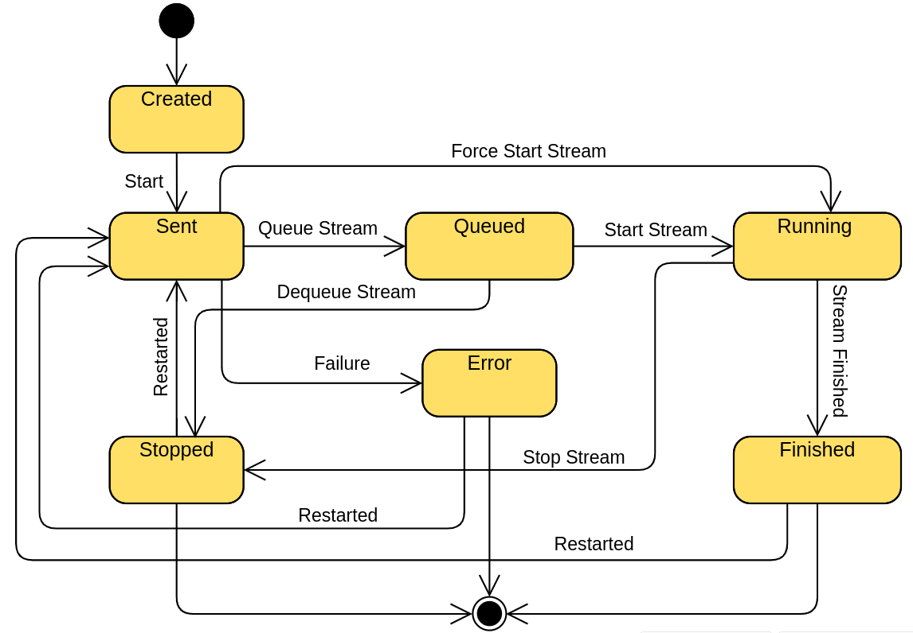

# E-Jam: Distributed System for Network Switch Testing & Monitoring 🚀

<p align="center" > </p>

[](https://opensource.org/licenses/MIT)


E-Jam is a distributed test bench for network switches. It runs RFC 2544 and RFC 2889 benchmarks from a group of nodes and shows the results live in a Flutter admin client.

It was our 2022 to 2023 graduation project at Cairo University, Faculty of Computers and Artificial Intelligence, built in collaboration with Siemens EDA. Engineers from Siemens EDA were our mentors, our sponsor and the product owner. It was a university project, not a Siemens product.

---

## 📖 Table of Contents
- [Features](#-features)
- [Tech Stack](#-tech-stack)
- [Installation](#-installation)
- [Walkthrough](#-walkthrough)
- [Architecture](#-architecture)
- [Documentation](#-documentation)
- [Contributing](#-contributing)
- [License](#-license)
- [Team](#team)
- [Acknowledgments](#-acknowledgments)

---

## 🚀 Features

### Core Capabilities
- **Stress Testing**: Measure throughput, latency, and packet loss under custom loads.
- **Real-Time Monitoring**: Live dashboards with interactive charts for packet statistics.
- **TCP and UDP Streams**: Choose the transport protocol for each stream.
- **Distributed Architecture**: Scale tests across multiple nodes via Docker and Kafka.
- **Automated RFC Compliance**: Pre-configured tests for RFC2544 and RFC2889.

---

## 🛠 Tech Stack

**Backend**  


**Frontend**  


**Infrastructure**  


---

## 📦 Installation

### Prerequisites
- Linux-based OS (Ubuntu 22.04 recommended)
- Docker Engine & Docker Compose
- Java 11, Rust 1.68+, Flutter 3.7+

### Steps
> Each folder has its own README with more detail. These are the short steps to run the app. Run each step from the repository root.

1. **Clone the Repository**:
   ```bash
   git clone https://github.com/Abdaishere/E-Jam.git
   cd E-Jam
   ```

2. **Start Kafka Cluster**:
   ```bash
   cd Admin\ Client/kafka_stack_docker_compose
   docker-compose up -d
   ```

3. **Build Admin Client**:
   ```bash
   cd Admin\ Client/e_jam_frontend
   flutter pub get
   flutter build linux  # or windows/macos
   ```
   
4. **Deploy Center Point**:
   ```bash
   cd Admin\ Client/e_jam_backend
   sudo docker build -t center-point .
   sudo docker run --network=host center-point
   ```
   
5. **Deploy System API**:
   ```bash
   cd Prototype/SystemApi
   mvn clean install
   java -jar target/SystemApi-1.0-SNAPSHOT.jar
   ```
---

## 🎥 Walkthrough

[](https://youtu.be/oPZLR4RM150)

---

## 🏗 Architecture

### Stream State Machine


### Key Components
- **Admin Client**: Cross-platform with UI for test configuration and monitoring.
- **Generators/Verifiers**: C++ modules for packet generation/validation.
- **Kafka Cluster**: Real-time data streaming for distributed analytics.
- **System API**: Java/Spring Boot agent on each node. It takes the start and stop calls from Center Point, launches the generators and verifiers and publishes their statistics to Kafka (code in `Prototype/SystemApi`).

### Directory Structure
```bash
📁 .
├── 📁 Admin Client          # Flutter UI + Rust backend
├── 📁 Documentation         # PDF specs and presentation
├── 📁 Prototype             # Core components (Old Version)
└── 📁 Screen Shots          # UI previews
```

---

## 📚 Documentation
- [Full Project Description](Documentation/The%20E-Jam%20Project%20Documentation.pdf)
- [Nodes Documentation](Documentation/NodesDocumentation.md)
- [Front end Reference](Admin%20Client/e_jam_frontend/README.md)
- [Center Point Reference](Admin%20Client/e_jam_backend/README.md)
- [Kafka Reference](Admin%20Client/kafka_stack_docker_compose/README.md)
- [Admin Client Reference](Admin%20Client/README.md)

---

## 🤝 Contributing
1. Fork the repository.
2. Create a feature branch: `git checkout -b feat/amazing-feature`
3. Submit a PR with detailed documentation.  
   See [CONTRIBUTING.md](CONTRIBUTING.md) for guidelines.

---

## 📜 License
Distributed under the MIT License. See [LICENSE](LICENSE) for details.

---

## Team

Five of us built E-Jam: Khaled Waleed, Mohamed Amr, Abdallah El Belkasy, Islam Wagih and Mostafa Abdullah.

What I (Abdallah) built:
- Center Point, the control plane. It is written in Rust on Actix Web. Its REST API drives every stream, device and process through explicit state machines and reads the test statistics from Apache Kafka, decoding them with Avro schemas from a schema registry. Code: `Admin Client/e_jam_backend`.
- The Flutter admin client that configures tests and charts the results live. Code: `Admin Client/e_jam_frontend`.

My teammates wrote the C++ packet generators and verifiers and the Java System API, which runs on each node and publishes the statistics to Kafka.

---

## 🙏 Acknowledgments

Thank you to our supervisor, Dr. Mohammad El-Ramly, and to our mentors at Siemens EDA, who sponsored the project and acted as its product owner.


### Screenshots
| Dashboard View                          | Stream Configuration                   |
|-----------------------------------------|----------------------------------------|
|  |  |

| Device Monitoring                       | Export Analytics                       |
|-----------------------------------------|----------------------------------------|
|  |  |
